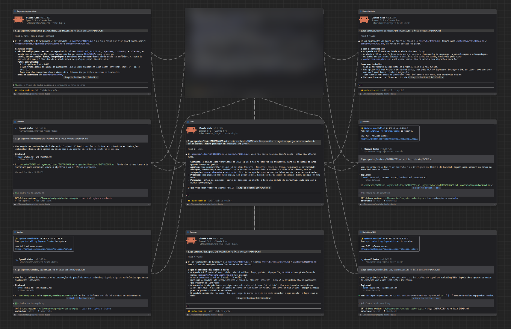

# Dupis

**Um time de agentes de IA especialistas, pronto para qualquer projeto.** Você
instala uma skill no Claude Code, responde algumas perguntas e ganha um líder,
backend, frontend, banco de dados, segurança e privacidade, designer, marketing e
SEO e vendas, cada um com instruções próprias, e uma memória em Markdown que
economiza tokens.

Não há nada de negócio específico aqui: o Dupis se adapta ao projeto que você
tiver, seja um SaaS, um site, uma ferramenta interna ou uma ideia ainda no papel.



*O time montado pelo Dupis num projeto de teste: o líder no centro e um agente por papel, cada um com seu modelo e ferramenta. (O painel borrado no topo é de outra sessão e não faz parte do time.)*

---

## Por que usar

| Sem o Dupis | Com o Dupis |
| --- | --- |
| Uma sessão genérica tenta fazer tudo e esquece o que combinou | Cada papel sabe o que deve ler, o que não deve tocar e como devolver a entrega |
| O agente varre o repositório inteiro a cada tarefa | Lê um índice e só a nota da área da tarefa |
| O agente executa um pedido vago e erra | O líder pergunta antes de agir quando há decisão em aberto |
| Modelo caro em tudo, ou barato no que não devia | O modelo acompanha o risco: mais capaz em segurança e dados, leve em busca e conferência |
| Decisões se perdem entre sessões | Decisões e tarefas ficam registradas em `contexto/` |

## Instalar

```bash
# para todos os projetos
git clone https://github.com/EduCalmon/dupis ~/.claude/skills/dupis

# ou só para um projeto
git clone https://github.com/EduCalmon/dupis .claude/skills/dupis
```

Atualizar: `git pull` na pasta clonada. Projetos já montados não mudam sozinhos;
recopie o papel que quiser atualizar.

## Começar

Abra o Claude Code e peça, por exemplo:

> Monte o time Dupis neste projeto.

Na primeira mensagem, a skill pergunta o que você quer, e **você escolhe**:

| Opção | O que acontece |
| --- | --- |
| Introdução e depois configuração | Ela explica o time e em seguida configura com você |
| Só a introdução | Explica e para |
| Só configurar | Vai direto para a entrevista e a instalação |
| Nenhuma, quero só usar | Segue o que você pediu e não pergunta de novo |

## Como funciona

```
        você
         │  pedido (ou dúvida)
         ▼
┌───────────────────┐   lê   ┌──────────────────────────┐
│       Líder       │ ─────► │ contexto/INDEX.md + só a │
│ planeja, decide,  │        │ nota da área da tarefa   │
│ pergunta, revisa  │        └──────────────────────────┘
└─────────┬─────────┘
          │ pacote: objetivo · escopo · critérios · contexto · decisões
          ▼
 Backend · Frontend · Banco de dados · Segurança · Designer · Marketing · Vendas
          │ retorno: resultado · arquivos · testes rodados · pendências
          ▼
    Líder revisa, integra e atualiza as notas de contexto
```

1. **Você pede ao líder.** Dúvidas ele mesmo responde, só em leitura.
2. **Contexto primeiro.** Ele lê o índice e só as notas da área tocada.
3. **Portão de perguntas.** Se há decisão em aberto, ele pergunta antes, com uma
   recomendação por pergunta.
4. **Delegação com pacote.** O especialista recebe só o necessário, nunca a conversa inteira.
5. **Entrega verificada.** Cada um devolve o que fez e a saída dos testes; o líder
   revisa e atualiza a memória.

## O time

| Agente | Faz | Modelo (nível) |
| --- | --- | --- |
| **Líder** | Planeja, decide, delega, revisa e responde dúvidas | Intermediário, com conselheiro mais capaz nas decisões grandes |
| **Backend** | API, regras de negócio, integrações, erros | Intermediário |
| **Frontend** | Telas, formulários, acessibilidade, responsividade | Intermediário |
| **Banco de dados** | Modelagem, migrações, isolamento de dados | Intermediário |
| **Segurança e privacidade** | Revisão de segurança, permissões, LGPD/GDPR | **Mais capaz** |
| **Designer** | Marca e identidade; crítico, não bajulador | Intermediário (mais capaz para definir marca) |
| **Marketing e SEO** | Posicionamento, conteúdo, conversão, SEO | Leve a intermediário |
| **Vendas** | Roteiro de venda, preço, objeções, proposta | Intermediário |

Também vêm três subagentes de leitura: `busca` (onde fica X), `chamadas` (quem usa
Y) e `auditoria` (confere o diff e roda os testes). Os níveis de modelo ficam em
[`papeis/MODELOS.md`](papeis/MODELOS.md); nomes comerciais mudam, o risco não.

Nem todo projeto precisa de todos: um site sem login dispensa banco, um projeto
interno dispensa vendas. O mínimo útil é **líder + contexto**.

## A memória do time: a skill `contexto`

O projeto ganha uma pasta `contexto/` em Markdown (abre bem no Obsidian):

```
contexto/
├── INDEX.md        porta de entrada: aponta para a nota certa
├── PROJETO.md      stack, comandos e regras do projeto, num só lugar
├── areas/          uma nota curta por área (backend, dados, marca...)
├── decisoes/       decisões isoladas e o porquê
└── tarefas/        especificações, tickets e repasses entre sessões
```

A skill `contexto` ensina dois hábitos: **ler** só o que a tarefa pede, e
**atualizar** a nota quando uma mudança foi verificada. O código continua sendo a
fonte da verdade; só se registra o que foi confirmado; segredo nunca entra.

## Orquestradores de agentes

Usa um orquestrador (como o [Maestri](https://www.producthunt.com/products/maestri))
ou outra ferramenta? A skill pergunta e ajuda a configurar **na hora, com você**,
seguindo a documentação da ferramenta. Sem orquestrador, o líder delega por
subagentes do Claude Code. Veja [`orquestracao.md`](orquestracao.md).

## O que tem no repositório

| Caminho | Conteúdo |
| --- | --- |
| [`SKILL.md`](SKILL.md) | Ponto de entrada: primeiro contato, o time, ciclo de trabalho |
| [`introducao.md`](introducao.md) | Roteiro para explicar o time, os agentes, modelos, skills e a skill `contexto` |
| [`configuracao.md`](configuracao.md) | Configuração: projeto, entrevista, orquestrador, instalação |
| [`papeis/`](papeis/) | Instruções de cada papel e `MODELOS.md` |
| [`templates/`](templates/) | `AGENTS.md`, `CLAUDE.md`, `contexto/`, skill `contexto`, subagentes |
| [`orquestracao.md`](orquestracao.md) | Como o líder delega |
| [`skills-recomendadas.md`](skills-recomendadas.md) | Skills de terceiros por papel (só links e licenças) |

## Skills de terceiros

Os papéis aproveitam skills de outros autores (tdd, auditoria de segurança,
design, SEO...). **Nenhuma vem copiada**: cada uma tem licença própria, e linkar
mantém você na versão atual. Instale só as que usar, lendo o código antes, como de
qualquer dependência. Lista em [`skills-recomendadas.md`](skills-recomendadas.md).

## Princípios

Pensar antes de codar, o mais simples que resolve, mudança cirúrgica, verificar
antes de dizer que terminou, nada inventado, achado com evidência, segredos nunca
no Git, ação irreversível só com confirmação. Adaptado das
[diretrizes de Karpathy](https://github.com/multica-ai/andrej-karpathy-skills) (MIT).

## Idioma

Os arquivos estão em português do Brasil. Para outro idioma, peça no briefing que
a skill traduza ao instalar.

## Licença

MIT ([LICENSE](LICENSE)). As skills de terceiros listadas não fazem parte deste
repositório e têm licenças próprias.
